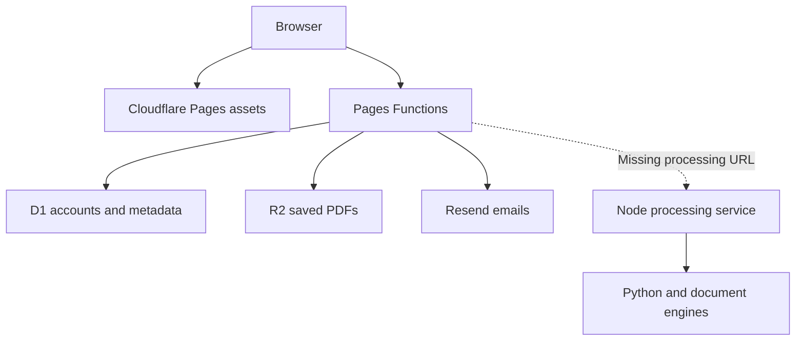

# YoqArt repair release — 15 November 2026

## Scope and baseline

Repository main before repair: `a80ccd571584cdaf8d5ab1e7d5930fcd66469b24`.
Cloudflare canonical production before repair: `6560f4a180f970ddf0926d6ca683a78d82e519ca`.
Rollback deployment: `2a30316c-0a62-49a4-a746-4c4dc399ac27`.

Cloudflare Pages project `yoqart` serves `public/`; Pages Functions implement accounts and proxy native processing. D1 `yoqart-db` contains existing users, sessions, tokens and document metadata. R2 `yoqart-files` already exists, but its binding was absent from the inspected deployment config. Resend reports the sending domain verified. The production configuration has a Resend secret entry; its value is not exposed by the API and delivery is not yet verified.

## Confirmed issues and implemented repairs

| ID | Severity | Evidence / root cause | Repair and verification |
|---|---|---|---|
| YOQ-001 | Critical | Main stores package, config, source and homepage as Base64. Cloudflare build ff857781 fails with invalid TOML/JSON/JS. | Restore UTF-8 source. Pages bundle now builds. |
| YOQ-002 | Critical | Decoded `_auth.js` exports only sameHash although routes import many helpers. | Restore explicit exports; compiled bundle and isolated D1 lifecycle pass. |
| YOQ-003 | High | No authentication rate limiting; multi-statement token consumption can race; pending account deleted on delivery error. | Atomic D1 batch consumption, IP rate limits, generic recovery responses, retained pending signup, escaped emails, bounded inputs. Tests cover verify/replay/expiry/reset/session revocation. |
| YOQ-004 | High | Password hashing requests 120,000 iterations, exceeding some Workers runtimes' per-call cap. | Existing records remain verifiable. New versioned hashes chain six 100,000-iteration derivations; native limit is respected without reducing total work. Legacy fallback is retained. Actual existing-user login still needs owner credentials to verify. |
| YOQ-005 | High | No PROCESSING_API_URL configured; native processing returns 503. | Whitelisted proxy and explicit service availability state. Native implementation tested locally; production remains blocked pending a host. |
| YOQ-006 | High | Health always returns ok despite missing dependencies. | Health queries D1 and reports email, R2 and processing configuration separately. |
| YOQ-007 | High | Saved-document R2 binding missing from inspected production configuration. | Bind existing bucket in versioned config; no document/account deletion or schema reset. |
| YOQ-008 | High | PDF-to-PPT handler only displays a success sentence. | Generate an image-based PPTX using real rendered pages. Browser verification required before claiming pass. |
| YOQ-009 | High | Office-to-PDF prompts for pasted text; spreadsheet preview passes a Promise to XLSX. | Real upload routes through LibreOffice; await spreadsheet bytes and provide PDF download. Native Word and Excel conversion integrity pass locally. |
| YOQ-010 | High | Unlock/repair/PDF-A all call unencrypted re-save, with ignoreEncryption=true. | Reject encrypted input in browser operations. Password-aware native unlock, real repair, disable unvalidated PDF/A. Native encrypt/unlock/wrong-password/repair tests pass. |
| YOQ-011 | Medium | Split lacks ZIP modes; file input survives tool changes; no remove/touch reorder; lenient page ranges. | Individual/range ZIPs, reset state, remove and up/down controls, strict page validation. PDF integrity suite passes. |
| YOQ-012 | Medium | Compare only reports page counts; OCR silently processes first 10 pages. | Compare actual extracted text and download a report. Reject OCR >10 pages explicitly; text output download. Neither claims visual diff or searchable OCR PDF. |
| YOQ-013 | High | Raw DOCX HTML preview and provider error strings enter HTML; PDF text can become spreadsheet formulas. | Sanitize preview, escape errors, force extracted XLSX text cells to string type. |
| YOQ-014 | Medium | Calculator accepts negative/invalid amounts and zero division; invoice preview item taxable selector is broken. | Numeric validation, zero-division error, working scoped selectors, consistent discounted totals, paise-aware amount words. Independent arithmetic tests pass. |
| YOQ-015 | Medium | Wrong new-Act TDS interest references; fixed GST menu omits special rates; flat salary estimate misleading. | Correct references against official rates; custom GST rate; explicit rate-only estimate and unsupported salary error. Tax eligibility/threshold automation remains out of scope. |
| YOQ-016 | High | Public proxy forwards arbitrary endpoint paths and request headers; no processing concurrency limit. | Endpoint allowlist, minimal headers, optional backend secret, timeouts, bounded uploads and active jobs, process group kill. |
| YOQ-017 | Medium | Compression silently retries lower quality and lacks output integrity validation. | Preserve selected quality; validate output page count; original returned with truthful unchanged flag when not smaller. Native test passes. |
| YOQ-018 | Medium | Third-party ad scripts invoke an unavailable advertising page during navigation; old dependencies loaded eagerly. | Remove invocation/popunder scripts, preserve empty ad slots, self-host processing libraries, lazy OCR/PPT loading. No branding redesign. |
| YOQ-019 | High | Dependency audit found image-size infinite-loop advisories via PPTX package. | Override to fixed version; latest production npm audit reports zero advisories. |

## Verification performed

- 25 Node checks pass: isolated D1/R2 account lifecycle with mocked email, password compatibility, tool views for 46 entries, strict ranges, merge/split/reorder/rotate/crop/watermark/numbers/annotations and ZIP integrity, arithmetic and invoice totals.
- 10 native integration checks pass with actual HTTP uploads and generated files: health, DOCX, XLSX numeric values, protection/unlocking/wrong password, compression flag, Word/Excel conversion, repair, malformed upload and unknown API.
- Real Chrome preview: uploaded two PDFs, reordered files, processed and downloaded a four-page merged PDF; downloaded bytes parsed successfully.
- Pages Functions bundle compiles successfully. npm production dependency audit reports zero advisories after remediation.
- No production migration or account reset has been performed. Read-only baseline counts: 2 users, 2 verified users, 1 session, 2 document records.

## Remaining limits / release blockers

Native engines cannot run in Pages. A container host and HTTPS processing URL are still required for Word/Excel conversions, Office-to-PDF, compression, encryption, unlocking, repair and media downloading. This release does not provision a paid host. Docker image build is unverified because Docker is unavailable in this environment.

PDF translation and validated PDF/A are explicitly unavailable. Redaction is not advertised and was not added. Typed signing is an overlay, not a cryptographic signature. Editing adds overlays, not embedded-text editing. OCR outputs text rather than a searchable PDF. Comparison is text-only; no image/layout diff. PDF-to-PPT slides are images. AI summarization is a local leading-sentence excerpt. These are not iLovePDF quality-parity claims.

Real email delivery, production existing-user login/reset, mobile hardware, Firefox/Edge/Safari, large/adversarial-file resource behavior and every tool's complete browser workflow are not verified. Tests use synthetic files only.

## Release / rollback

Merge the tested repair branch through a PR without force push. Existing Cloudflare Git integration deploys main. Confirm the canonical deployment SHA matches the merge commit, then check live assets, health, unauthenticated auth status, tool downloads and explicit native-service status.

Rollback application code with Cloudflare Pages rollback to the recorded deployment. D1/R2 are not rolled back with code; no data migration is required by this release. Never roll back by resetting databases or deleting documents. Keep the current existing D1/R2 bindings.

## Sources checked

- https://www.incometaxindia.gov.in/hi/w/tds-rates (Tax year 2026–27; interest mappings)
- https://www.incometax.gov.in/iec/foportal/help/all-topics/e-filing-services/tds-compliance (earlier payment/credit transition rule)
- https://www.pib.gov.in/PressNoteDetails.aspx?ModuleId=3&NoteId=160401&id=160401&lang=1&reg=1 (GST rate-structure announcement)
- https://github.com/cloudflare/workerd/issues/1346 (per-call PBKDF2 runtime limit)

Reference iLovePDF merge page was observed in a real browser: file picker, multi-file selection, drag/drop text and optional Drive/Dropbox. Reference processing, outputs and other tool pages have not been executed, so parity is not verified.
